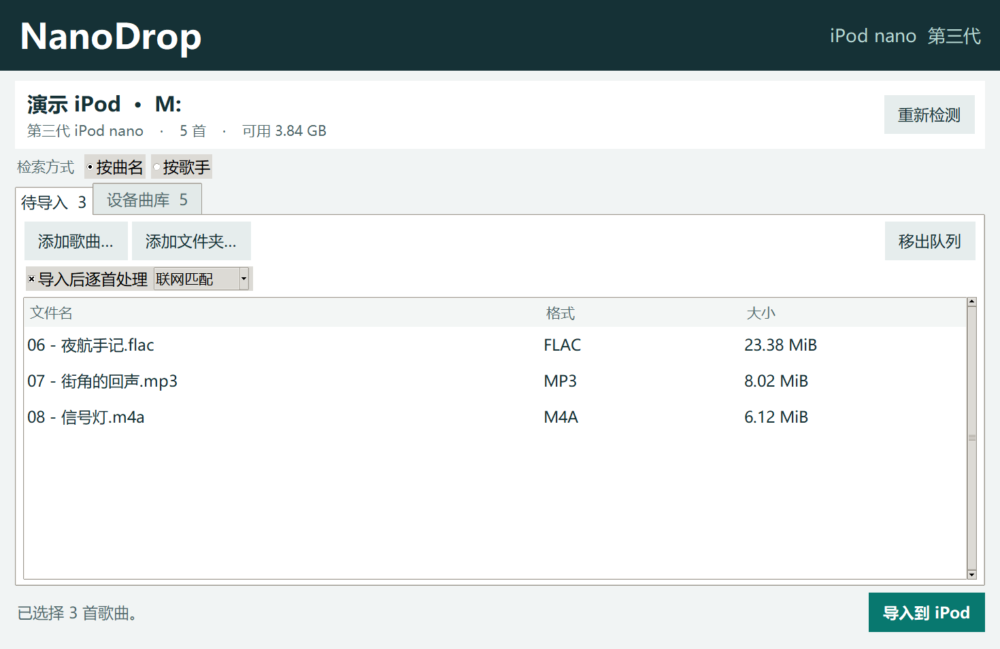
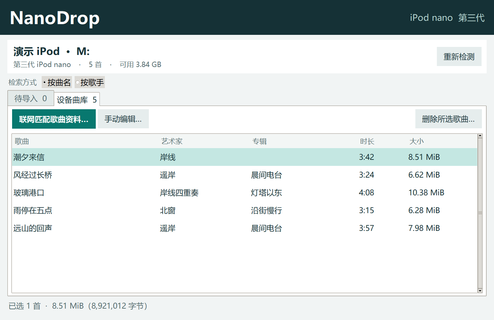
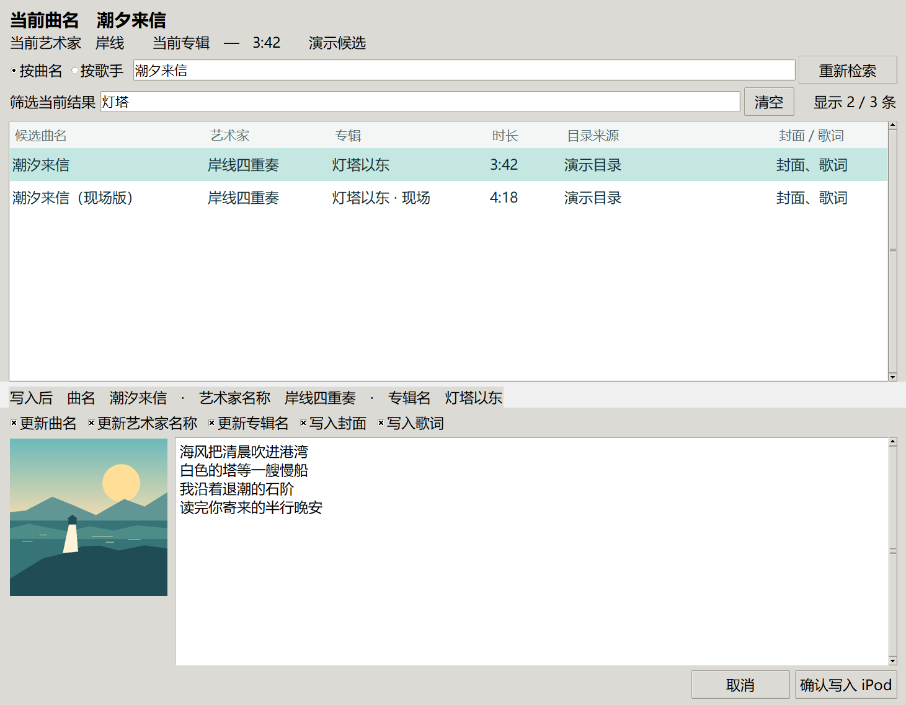
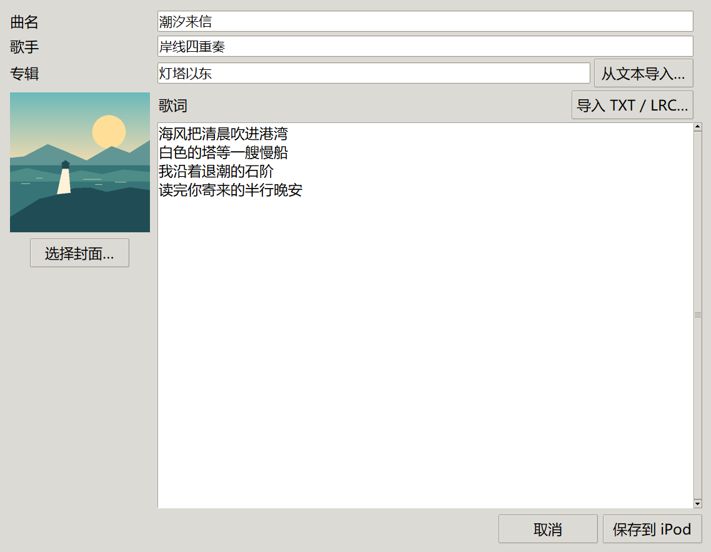
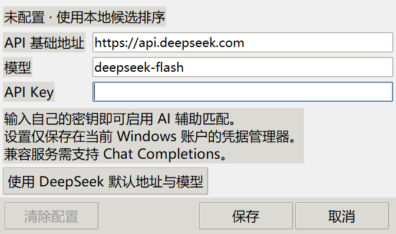

# NanoDrop

NanoDrop 是一款面向 **Windows x64 和第三代 iPod nano** 的本地音乐管理工具。你可以把电脑里的歌曲导入 iPod，整理设备曲库，再为缺少资料的歌曲补上曲名、艺术家、专辑、封面和歌词。运行发布版无需安装 Apple Music、iTunes 或 Python。

[下载 Windows 单文件版](https://github.com/lobc4ever/NanoDrop/releases/latest/download/NanoDrop.exe) · [查看版本说明和源码包](https://github.com/lobc4ever/NanoDrop/releases/latest)

## 首次连接

1. 双击 `NanoDrop.exe`，用 30 针 USB 数据线连接 iPod nano。
2. 等待主窗口显示设备名称、盘符、歌曲数和可用空间。已有歌曲会出现在「设备曲库」。
3. 选择要导入的音乐，或直接在曲库中选中一首歌编辑。等操作结束后，从 Windows 安全弹出设备。

下面五张图均截自 NanoDrop 1.6.1。图中的设备、歌曲、候选版本、封面和歌词均为演示数据。

## 把本地音乐导入 iPod

在「待导入」中拖入歌曲或整个文件夹，也可以点「添加歌曲」或「添加文件夹」。列表显示文件名、格式和原文件大小。选错的文件可以用「移出队列」移除。核对后点击右下角「导入到 iPod」。



- **原文件与转换**　兼容的 MP3、AAC-LC M4A 和 16 位 ALAC 可以原样导入。FLAC、WAV、AIFF、OGG、Opus 等音频按需转换为 iPod 可播放的 AAC。转码后的设备文件大小可能与队列中显示的大小不同。
- **导入后逐首处理**　勾选后，可选「联网匹配」或「手动编辑」。程序只为本次新加入的歌曲打开处理窗口，可以跳过某首或结束本次核对。
- **重复导入**　程序会跳过识别出的重复文件。如果以前由 NanoDrop 导入的歌曲仍在曲库里，但设备音频已经缺失，可以重新导入同一原文件，尝试补回音频并保留播放列表记录。

## 浏览曲库、查看大小与删除歌曲

「设备曲库」列出曲名、艺术家、专辑、时长和设备上的文件大小。点击「大小」列标题可升序或降序排列。选中一首后，窗口底部会显示精确字节数。大小前的 `≈` 表示采用曲库记录的估算值。「文件缺失」表示曲库中有记录，但对应的音频文件已找不到。



单选歌曲后可点「联网匹配歌曲资料」或「手动编辑」。要删除多首，按住 Ctrl 逐首选，或用 Shift 选中连续的一段，再点「删除所选歌曲」。确认后会移除设备音频、曲库记录和播放列表中的对应条目。原文件会先备份到电脑，可从「工具 → 打开曲库备份文件夹」找到操作备份。

## 联网匹配并核对候选

1. 在「检索方式」选择「按曲名」或「按歌手」。例如文件标签写着“潮夕来信”，可以按曲名做模糊匹配。只记得演唱者时，改用歌手名检索。
2. 在「核对候选歌曲」窗口，用上方检索词和「重新检索」发起新查询。要在已有结果中缩小范围，按 Ctrl+F 或点击「筛选当前结果」，输入曲名、艺术家或专辑关键词。用空格分隔的多个词需要同时匹配。
3. 对照专辑、时长和版本，选中一条候选。曲名、艺术家名称、专辑名、封面和歌词可以分别勾选。检查「写入后」预览，再点「确认写入 iPod」。



这个例子中，筛选词“灯塔”同时保留了原版和现场版。原曲时长为 3:42，与第一条候选一致。如果只想修正曲名，保留「更新曲名」一项即可。

联网目录包括网易云音乐、QQ 音乐、Deezer 和 LRCLIB，必要时补查 MusicBrainz 与 Cover Art Archive。封面和歌词取决于对应版本的目录资料。启用搜索 AI 后，它会辅助排序、建议下次查询的检索词，写入版本仍由你核对。

## 手动编辑曲名、艺术家、专辑、封面和歌词

在「设备曲库」选中歌曲，点击「手动编辑」。适合整理自己的录音，或手里已有确定的封面和歌词时使用。



| 想改的内容 | 在窗口中的操作 |
| --- | --- |
| 曲名、歌手 | 直接修改顶部对应的输入框。 |
| 专辑名 | 直接填写，或点「从文本导入」选择仅含一行专辑名的 TXT。 |
| 封面 | 点「选择封面」打开本地图片，例如 JPG 或 PNG。左侧会显示预览。 |
| 歌词 | 在文本框中粘贴，或点「导入 TXT / LRC」。LRC 的时间标签会移除，设备上显示纯文本歌词。 |

点击「保存到 iPod」后，曲名、歌手和专辑更新到设备曲库，封面写入设备缩略图库，歌词嵌入设备上的音频文件。

## 配置搜索 AI 与 API Key

打开「工具 → 搜索 AI 设置（API Key）」。首次使用时密钥栏为空。使用 DeepSeek 可以保留默认地址和模型，只填自己的密钥并保存。使用其他兼容 Chat Completions 的服务时，填写服务商的 **HTTPS 基础地址**（按需包含 `/v1`）、模型名和对应密钥。



配置保存在当前 Windows 账户的凭据管理器。更换服务地址时需要重新输入对应密钥。「清除配置」会删除此应用保存的搜索 AI 设置。未配置 AI 时，仍可联网查询音乐目录，候选使用本地相似度排序。

联网查询会把检索词发送给音乐目录。启用 AI 后，你选择的服务还会收到曲名、艺术家、专辑、时长、检索词和候选版本资料，用于比对歌曲。

## 连接与备份常见问题

**iPod 显示“OK to disconnect”，怎样判断电脑是否识别？** 打开 Windows「此电脑」看是否出现 iPod 盘符，再看 NanoDrop 是否显示设备和曲库。若没有盘符，可换一个直连 USB 口或数据线。需要进入 Disk Mode 时，可在「工具 → 连接帮助」查看按键步骤，然后点击「重新检测」。

**Windows 反复报告驱动器问题或 I/O 错误怎么办？** 先暂停导入和删除，备份仍可读取的文件，等 Windows 能稳定读取设备后再重新检测。NanoDrop 的曲库备份保存在电脑上，从「工具 → 打开曲库备份文件夹」即可进入。删除或编辑涉及的原文件位于相应设备的「操作备份」目录。

## 从源码运行和构建

在 Windows x64 上安装带 Tcl/Tk 的 Python 3.12，在仓库根目录打开 PowerShell，执行以下命令。

```powershell
py -3.12 -m venv .venv
.\.venv\Scripts\python.exe -m pip install -r requirements.txt
$env:PYTHONPATH = (Resolve-Path vendor).Path
.\.venv\Scripts\python.exe main.py
```

关闭应用后，在同一目录运行下列命令，即可生成 `dist\NanoDrop.exe`。

```powershell
.\.venv\Scripts\python.exe -m PyInstaller --noconfirm NanoDrop.spec
```

验证脚本可以在电脑上生成临时测试曲库，覆盖音频导入、重复文件、歌词、封面、搜索设置和中断恢复。运行方式见[使用与构建](使用与构建.txt)。

NanoDrop 采用 [GPL-3.0-or-later](LICENSE)。曲库引擎来自 iOpenPod，音频处理使用 Mutagen 和 FFmpeg。各组件的来源和许可见 [licenses](licenses/)。
